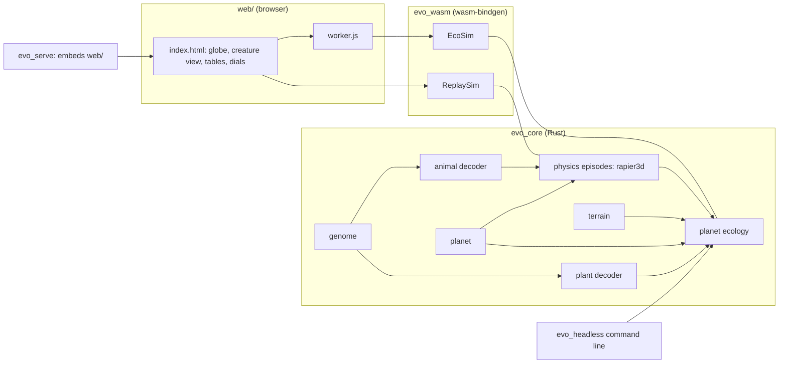
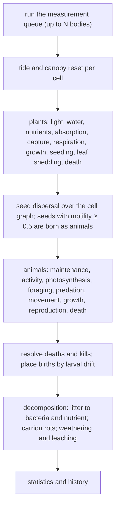
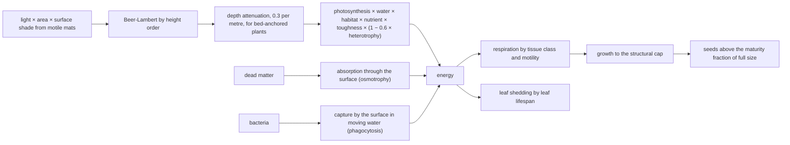
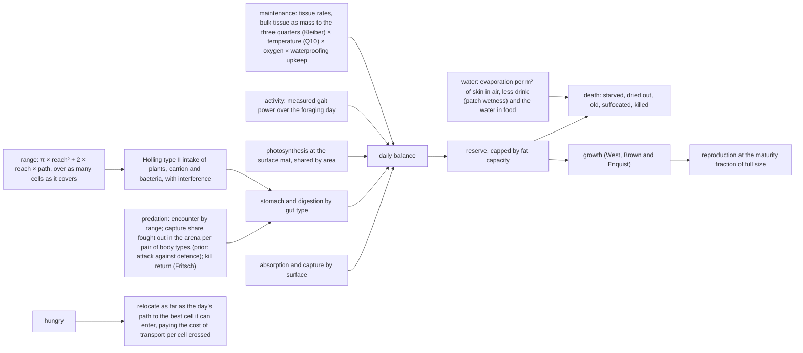
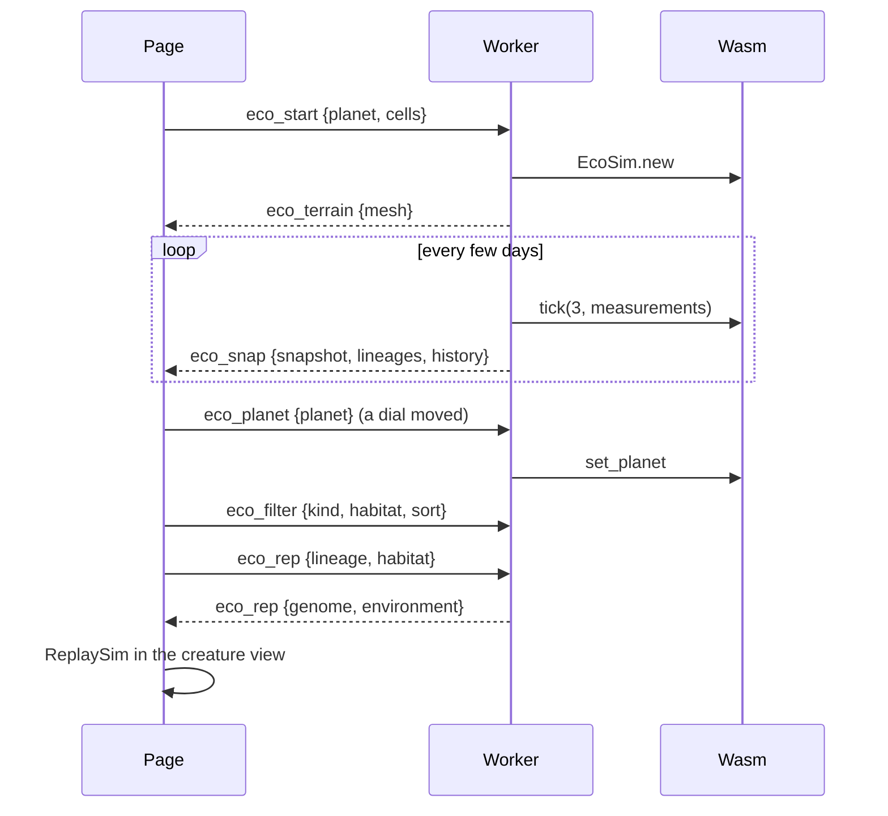

# Evo Planet: system specification

A reading guide to how the simulation is built: the data it holds, the
systems that act on it, the order they run in each day, and how the pieces
talk to each other. For *why* each rule exists and what it rests on, see
`MODEL.md` (design notes and audit log) and `RULES_AUDIT.md` (every number
and its backing). This document is the *what*.

Names are written out in full here even where the code abbreviates them;
the code name is given in brackets the first time.

Status 2026-11-03.

## 1. Overview

Evo Planet is a technology demo for a game, not the game itself: it shows
that bodies, abilities and an ecology can all come out of physics and
energy with nothing scripted. There is one mode, the planet ecology.
Nothing is scored or ranked. The physics only measures what a body can
do; the ecology decides what that is worth by making the body earn its
energy. An earlier archive-evolution mode (a scored task with a MAP-Elites
archive) was removed on 2026-11-03.

## 2. The genome

A directed graph of nodes with recursion limits, in the style of Karl
Sims (1994), plus a set of whole-organism genes. The same genome is read
as an animal body or as a plant body; the motility gene decides which,
and nothing an organism earns or pays jumps at that point.

### 2.1 Node

One node describes one kind of segment and the joint that attaches it to
its parent. A node can be expanded several times (a tail of repeated
segments, a leg of three joints) because connections may point back at
their own node up to the node's recursion limit.

| Field (code name) | Meaning | Range |
|---|---|---|
| length (`len`) | segment length, metres | 0.01 to 3 after scaling |
| radius at base (`r0`) | capsule radius at the base; for a sheet, half the sheet's width | 0.004 to 0.8 |
| radius at tip (`r1`) | capsule radius at the tip; for a sheet, its thickness gene (0.1 to 2 mm) | 0.004 to 0.8 |
| flatness (`flat`) | 0 a round capsule, 1 a thin sheet; every physical quantity blends on it | 0 to 1 |
| grip | 0 smooth skin, 1 a clawed, gripping foot | 0 to 1 |
| stiffness | 0 a free joint, 1 welded to the parent (a passive spring grows with it) | 0 to 1 |
| freedom | 0 one driven axis (a hinge), 1 three driven axes (a ball joint with twist) | 0 to 1 |
| limit | half range of joint motion, radians | |
| recursion limit (`recursive_limit`) | how many times this node may expand along one path | 1 to 4 |
| oscillator (`cpg`) | the segment's rhythm, see 2.2 | |
| connections | how child nodes hang off this one, see 2.3 | 0 to 4 |

The old `kind` (capsule, membrane, pad) and `joint` (hinge, ball, rigid)
labels are derived from the four form genes for display only; genomes
saved before the form genes existed resolve them from the labels.

### 2.2 Oscillator

Each node carries a small rhythm generator, in the code a central pattern
generator (`Cpg`), which is a biologist's name for a nerve circuit that
produces a repeating movement on its own, the way a spinal circuit drives
walking or a fin beat without the brain timing every stroke. Here it is a
sine wave per driven joint axis. Every joint target is
`bias + amplitude × sin(2π × frequency × time + phase)`.

| Field (code name) | Meaning |
|---|---|
| amplitude (`amp`), phase, bias | the hinge axis: how far, when in the cycle, and around what rest angle |
| sideways amplitude (`amp2`), sideways phase (`phase2`) | the second axis, a sideways swing, opened by the freedom gene |
| twist amplitude (`amp3`), twist phase (`phase3`) | the third axis, a twist about the segment's own length (a shoulder's pronation, which pitches a wing or a fin through its stroke), opened by the freedom gene |
| frequency multiplier (`freq_mult`) | 0.5, 1 or 2 times the genome's base frequency |

### 2.3 Connection

| Field | Meaning |
|---|---|
| target | which node the child is |
| along | where on the parent's length, 0 base to 1 tip |
| around | angle around the parent's axis, radians |
| pitch | tilt of the child from the parent's outward normal toward its tip |
| roll | roll of the child about its own axis |
| scale | multiplies every dimension of the child subtree |
| reflect | also make a mirror-image copy across the parent's symmetry plane |
| terminal only | expand only on the parent's last recursion |
| phase flip | the mirrored copy runs half a cycle behind (alternating gait) instead of in step (bounding, flapping) |

### 2.4 Whole-organism genes

| Gene (code name) | Meaning |
|---|---|
| base frequency (`base_freq`) | hertz of the oscillators |
| motility | 0 sessile (lives as a plant), 1 fully motile (lives as an animal); offspring at or above 0.5 are born animals |
| heterotrophy | investment in absorbing and capturing food through the surface, at the cost of photosynthetic machinery |
| breathing | 0 gills (water), 1 lungs (air); halfway breathes poorly in both |
| gut type (`gut_type`) | 0 a long fermenting gut, 1 a short carnivore gut; sets how well plant and animal tissue are assimilated |
| stomach fraction (`gut_frac`) | stomach capacity as a fraction of body mass |
| fat fraction (`fat_frac`) | energy reserve capacity as a fraction of body mass |
| offspring fraction (`offspring_frac`) | a newborn's mass as a fraction of adult mass |
| maturity fraction (`repro_frac`) | fraction of full size at which reproduction starts, for plants and animals alike |
| longevity | multiplier on the lifespan that mass sets |
| lifespan | a sessile organism's lifespan in days; blended with the mass-based lifespan by motility |
| seed mass (`seed_mass`), dispersal | a seed's mass and how far it travels (10 m per unit) |
| land tolerance (`land_tolerance`) | a plant's adaptation to air and dry ground; costs upkeep everywhere |
| leaf toughness (`leaf_toughness`) | tough leaves lose less to grazers and digest worse but photosynthesise slower |
| lung fraction (`lung_frac`) | share of the trunk's volume given to lungs or gills |
| water store (`water_store`) | extra trunk mass held as water, against aridity |
| density | tissue density, kg/m³ |

### 2.5 How and when the genome changes

Mutation happens only at reproduction. There is no recombination and no
change during life. A plant mutates every seed it makes; an animal's
birth is an exact copy one time in four and a mutated copy three times in
four. One mutation pass makes about one and a half changes on average,
whatever the genome's size (each element's chance is scaled by the number
of elements). The operators, in the order they run:

1. **Nudge every scalar gene** of every node by a relative Gaussian step
   (large values move by large amounts), and the four form genes by a
   small step, one time in five by a large one.
2. **Nudge the whole-organism genes.** Motility drifts in small steps
   with, one time in ten, a jump of about a third: a flagellum.
3. **Duplicate a segment** (serial homology): copy a node that is in use,
   with its attachment and its oscillator, onto the same host, further
   along it or mirrored. Two legs become four; a fin becomes a pair.
4. **Add a node** with random genes, attached somewhere reachable.
5. **Mutate connections**: nudge their pose, scale and pointers; add or
   remove one.
6. **Garbage collect** nodes no longer reachable from the root.

For an animal, the body's genes (node sizes and forms, joints, structure,
lungs, water store, motility, density) are hit at a fifth of the rate of
the rest (`BODY_MUTATION_SCALE`): morphology is conserved in life, and
every changed body is a physics measurement the planet has to afford. At
the full rate a populated world bred a thousand new bodies a day against
a few dozen measured, and a body measured never is only ever charged for
its new part.

A child whose body changed starts a new lineage with some probability
(one in five for animals, three in a hundred per seed); this is
bookkeeping for the table and has no effect on the organism.

## 3. The two bodies a genome can be

### 3.1 Animal phenotype (`decode.rs`)

The graph is expanded depth-first into up to 24 parts. Each part is a
blend, by its flatness, of a capsule of mean radius and a sheet of width
twice the base radius: mass, tissue volume (for buoyancy) and muscle
cross-section all blend. Lungs and stored water are added to the trunk.
Joined parts have their mass ratio clamped to 12:1 for the solver.

The muscle that moves a part sits on the segment it hangs from (a thigh
is swung by the hip, a wing by the chest), so a part's **maximum torque**
is 4000 newton-metres per square metre of its *parent's* cross-section.

| Phenotype field | Meaning |
|---|---|
| parts | the tree of parts, root first |
| total mass, membrane area, membrane mass | whole-body sums; membrane means sheet |
| torso volume, total muscle section | lung room; oxygen demand |

| Part field | Meaning |
|---|---|
| length, radii, blended radius, mass, density | size and substance |
| flatness, grip, stiffness, freedom, limit | the form genes, copied |
| anchor on parent, rotation from parent | joint placement |
| oscillator, maximum torque, muscle section, own section, reflected | drive and strength |

Body geometry also yields three **anatomical** quantities read off the
rest pose: mouth area (the trunk's front, times one minus its flatness),
claws (grip-weighted foot section over trunk section) and plating (the
share of mass held stiff on round parts). These are anatomy, not
abilities; every ability is measured (section 5).

### 3.2 Plant body (`plant.rs`)

Each part is leaf in proportion to its flatness (a sheet of width twice
the base radius and thickness from the tip-radius gene) and stem for the
rest; whatever lies below ground is root. Structure is checked under the
planet's gravity two ways: the bending moment at every stem from the
horizontal lever arm of all it carries, and Euler buckling of columns
with a 3 GPa modulus. The result is a **growth cap**, the fraction of full
size the stems can hold. Effective leaf area is the projection from nine
sky directions with overlap removed. Transport cost grows with the
kilogram-metres of stem between root and every leaf.

## 4. Physics episodes (`sim.rs`)

A creature simulation builds one body in rapier3d and steps it at 120 Hz
for a fixed episode (4 s in the ecology, after 1 s of settling with the
motors off; the air launch has no settling).

### 4.1 Environments

| Environment | Start | Ground and fluid |
|---|---|---|
| Land | placed on the ground with 1 cm clearance | flat ground, air |
| Water | where the body would rest: floating, on the bed or mid-water | 12 m deep, water below the surface |
| Air | launched forward at 3 m/s from 10 m | air; a thrown stone's distance is the baseline |
| Shore | 4 m seaward of the waterline | a bed rising 12 cm per metre (an audit probe, not used by the ecology) |

### 4.2 Configuration

| Setting (code name) | Meaning |
|---|---|
| time step (`dt`), settle time, episode time | 1/120 s, 1 s, 4 s |
| motors | false is the sham control: the same body with no muscle at all |
| amplitude scale (`amp_scale`) | 0 is the hold control: muscles hold the rest posture but do not swing |
| steer | asymmetric drive, mirrored parts get less and the others more: how a body turns |
| bias shift (`bias_shift`) | added to every joint's rest angle: the posture shift used to climb or dive |

### 4.3 Forces each step

- **Joint motors.** Each joint has three driven axes: the hinge, the
  sideways swing and the twist about the part's length; freedom opens
  the last two. Torque follows a Hill force-velocity limit (zero at
  25 rad/s), a passive spring proportional to stiffness holds the rest
  pose, and limits shrink with stiffness.
- **Sheet forces**, in proportion to flatness, on four sub-panels. Below
  the stall (about 15 degrees) the flow is attached: lift perpendicular to
  the relative wind with the thin-aerofoil slope 2π, reduced for the
  panel's aspect ratio along the wind, plus induced drag. Past the stall:
  the flat-plate normal force (2.61 sin α cos α). The two are blended
  across the stall. Attached lift is what lets a flapping wing push:
  the lift vector tilts with the stroke.
- **Capsule drag**, in proportion to one minus flatness, on three samples
  along the axis (0.5 axial, 1.1 lateral).
- **Force limiter**: no sample's fluid force may exceed what would stop
  its share of the part in one step.
- **Spin drag** about the part's own axis; **rolling resistance** (0.05)
  on ground contact; **buoyancy** from tissue volume; submersion damping.

### 4.4 What an episode reports

| Result (code name) | Meaning |
|---|---|
| distance, sustained speed (`sustained_speed`) | horizontal progress; progress over the second half only, so a topple or an initial roll does not count |
| yaw rate, climb speed | trunk turning rate and vertical speed over the second half |
| airborne fraction, time aloft, air distance | share of steps off the ground; seconds before first landing; horizontal distance at first landing |
| mean height | centre-of-mass height above ground, averaged (uprightness) |
| swept reach (`swept_reach`) | the farthest any part's end got from the centre of mass during the episode |
| belly contact (`trunk_contact_frac`) | share of steps in which the trunk touched the ground: 0 carried on limbs, 1 dragging |
| footfalls, stepping limbs | ground-contact onsets of parts other than the trunk; how many different parts made them |
| trunk clearance, trunk spin | how high the trunk's lowest point rides (m); the trunk's mean angular speed (rad/s): a tumble or a roll shows here |
| work, cost of transport | joules the joints did (motor torque against angular rate, each axis, each step); work per kilogram per metre of progress |
| energy leak | mechanical energy gained minus work, joules: friction and drag only remove energy, so anything above zero is a leak in the physics |
| shore progress, exploded | beach probe; the run went non-finite or past 60 m/s and is discarded |

## 5. Measurement, not scoring

Every ability an organism has in the ecology comes from physics episodes
with a control. A body is measured when it is born and again at half its
adult mass; a body identical to its parent's inherits the parent's
measurements, and a changed body uses them as a neutral prior until its
own episodes run.

| Ability | Episode | Control | Definition |
|---|---|---|---|
| land speed | land, motors on | the same body, motors off | sustained speed minus the control's |
| uprightness | land, motors on | | mean height over half the reach |
| turn rate (land, water, air) | asymmetric drive | symmetric drive | difference in yaw rate |
| water speed | water, motors on | motors off | sustained speed minus the control's |
| climb speed (water, air) | posture shift | no shift | difference in vertical speed |
| glide | air, wings held (amplitude 0) | a thrown stone | metres beyond where the stone lands |
| powered lift (`flap_lift`) | air, full stroke | the same body holding its wings | metres of mean height the stroke adds |
| sustained air speed | air, full stroke | | distance over the episode, only if aloft for 95% of it and past 5 m |
| reach | land, water, air | | the swept reach, the largest over the environments measured |
| gait power, cost of transport | land, water | | what moving costs: the episode's joint work per second at full drive, and per kilogram per metre; the ecology charges movement with these |
| gait signature | land | | stepping limbs, trunk clearance and trunk spin, reported in the lineage tables |

The air battery runs only for bodies light enough for wings to matter
(wing loading under 50 kg/m²). A **glider** is a lineage whose held wings
carry it 10 m beyond the stone (a glide angle under 45 degrees); a
**powered flier** is one whose stroke lifts it at least half a metre over
holding still.

The claim "flapping makes it fly" is held to this test in the code
(`flapping_and_feathering_sheets_add_lift`): a bat-like body whose chest
flaps the arm and twists the shoulder a quarter cycle later stays higher
than the same body holding its wings, while the same body with the sheets
replaced by rods of the same mass falls like a stone. Because the flight
dynamics are chaotic at the level of a float rounding, the claim is made
over an ensemble of mountings, frequencies and feather phases and judged
by its mean, its share of positive cases and its best case. Before the
shoulder twist and the attached-flow lift existed, no mounting, frequency
or feather phase produced lift; both findings are recorded in `MODEL.md`.

Movement is paid for with these measurements: an animal's daily activity
costs its gait's measured power over the foraging day, and a move
between cells costs its measured cost of transport, both through muscle
efficiency (a quarter) and 18 MJ per kilogram of dry biomass. The
muscle-section estimate remains only as the prior for a body not yet
measured.

Whether this physics can produce an upright, multi-segment gait at all
was settled by a direct search on the land episode (`examples/gait_search`,
an audit tool): it can, once walking is what pays. The found bodies are
in `docs/gaits/`, with frames; the stages the search went through and
the measurement bugs it exposed are in `MODEL.md`.

Three quantities are read from anatomy rather than measured: mouth area,
claws and plating. They enter the ecology as what a body *is*, in the
same way mass does.

### 5.1 The arena: predation fought out

Whether one body type can eat another is not a formula either. When a
predator first considers a prey of a given body type in a given medium
(land or water), the pair is queued for the arena (`arena.rs`): both
bodies in one physics world, the predator steering at the prey and the
prey steering away through a bearing controller on the turn their own
tests measured (its sign comes from the turn test). A bout ends when the
predator has held the prey for one second with its mouth (the front of
the trunk, with a gape of the trunk's diameter, on a prey part that fits
in it) or with a clawed foot in contact: **eaten**. If time runs out
(6 s) with no bite ever landed and the prey farther away than it started:
**fled**. Otherwise: **survived**. A pair is fought ten times from
perturbed starts (the prey's facing within half a radian of straight
away, its side offset within half its reach) and the three shares are
cached per (predator type, prey type, medium) and reused for every later
meeting of the same types. Until a pair has been through the arena, the
older attack-against-defence form stands in as a prior. One pair costs
about 24 single-body episodes of the physics budget.

Nothing about size, speed, weapons or armour enters the arena except
through the bodies themselves: a mouth too small for a thick prey finds
no purchase, a slow chaser never arrives, a prey that cannot turn is
caught from behind.

## 6. The world (`terrain.rs`, `planet.rs`, `eco.rs`)

The planet is a Fibonacci sphere of cells, six neighbours each. The cell
is a run parameter (100 m² by default); every rule is per square metre
or per metre, so the cell size must change nothing but resolution.
Terrain is ridged noise; sea level is the elevation quantile matching the
water-coverage dial; temperature falls with latitude and 6.5 °C per
kilometre. Shore cells carry a submersion that swings with a spring-neap
tide and blends breathing, light, water and locomotion between sea and
land.

| Structure | Fields |
|---|---|
| planet parameters | gravity, pressure, O₂ and CO₂ fractions, mean temperature, water coverage, humidity, insolation |
| derived | air and water density, oxygen availability, productivity factor, aridity, flight index |
| world (`EcoWorld`) | planet, cells, neighbours, plants, animals, day, cell area, terrain seed, trait cache by body, measurement queue, statistics, history |
| cell (`Patch`) | position, elevation, temperature, water, shore, moisture, submersion, nutrient, dead matter, carrion and bacteria pools, canopy, light left, motile mat area |
| plant | genome, body, lineage, cell, biomass, energy, age, height, light and water shares |
| animal | genome, body key, traits, lineage, cell, mass, reserve, stomach (plant, meat), age, kills, offspring, what it ate, intake rate |
| traits | mass, membrane area and mass, muscle section, activity, the measured abilities of section 5, mouth area, claws, plating, and which environments were measured |

The planet can change under a running world: sea level, climate and
gravity follow the dials, plant structure is rescaled, and every body is
queued for a fresh measurement when gravity, pressure or oxygen changed.

## 7. The daily tick

### 7.1 Plants, per cell

### 7.2 Animals, per individual

Water is a second balance beside energy. A body in air loses
`EVAPORATION_KG_PER_M2_DAY` (1 kg) per square metre of surface per day,
scaled by the air's dryness (one minus the cell's moisture), by warmth and
by the integument: the land tolerance gene is a plant's cuticle on one
side of the motility continuum and an animal's waterproof skin on the
other, cutting the loss by up to 95% and costing 30% more maintenance
when fully expressed. The surface is the compact body's (6 × (mass /
1000)^(2/3) m²) or both faces of its sheets, whichever is larger. Fresh
food carries water (4 kg per kg of dry plant, 2.5 per kg of meat); dew
settles on the body's surface (0.2 kg/m² on a fully humid night); in or
beside open water the deficit is made up each day. Humid ground is not a
drink: inland, the water is in the food. A deficit beyond 15% of body mass plus the
water-store gene's share is death by drying out. Nothing here is a
threshold on size or form: a sheet on dry land dries in a day because it
is all surface, a tiny body because surface per kilogram falls with size,
and either can live on land once its skin is waterproofed or the ground
is wet.

### 7.3 Energy accounting

Every quantity is kilograms of dry biomass equivalent per day.

| Flow | From | To |
|---|---|---|
| net primary production | light on leaf and membrane area | plant and mat biomass |
| absorption (osmotrophy) | dead matter pool | organisms, by surface area |
| capture and filter feeding | bacteria pool, suspended fraction | organisms, by surface and clearance |
| grazing | plant leaf mass | animal stomach |
| predation | prey (80% edible) | predator stomach |
| scavenging | carrion pool | animal stomach |
| maintenance and activity | reserve | heat |
| litter and corpses | shed leaves, deaths | dead matter, carrion |
| decomposition | dead matter | bacteria (yield 0.4) and nutrient |

The audit examples (`seed_ledger`, `gait_audit`, `flier_audit`,
`origin_probe`, `flap_probe3`) print the per-individual ledgers behind
the aggregate numbers.

## 8. Interfaces

| wasm object | Methods |
|---|---|
| `EcoSim` | tick(days, measurements), set_planet, snapshot_json, lineages_json(kind, habitat, sort, max), representative_json, plant_representative_json, terrain_json, immigrate |
| `ReplaySim` | one episode stepped in the browser: parts_json (with flatness and grip), transforms, centre of mass, distance, slope |

The page holds the three.js globe coloured from the snapshot, the
creature view (replay with camera follow and continuous form rendering),
the ecology panel (statistics, flows, deaths, filtered lineage table) and
the planet dials, always live. `window.evoDebug` exposes replayGenome,
setZoom, replayTime and replayDistance for scripted screenshot audits.

`evo_headless --planet earth --days N --grid cells --seed S
[--patch-area m2] [--evals-per-day k]` prints the daily ledger and
lineage tables.

## 9. Invariants the model is held to

1. **Every rule is per area or per metre.** The cell size changes nothing
   but resolution (tested at 25, 100 and 400 m² on a fixed 6 hectares;
   the two finer cuts agree within about a quarter, the coarse one not yet).
2. **No binary switches in biology.** Form, joints, breathing, diet,
   maintenance, lifespan and reproduction are continua on genes. The one
   remaining split is in code: below motility 0.5 an organism is ticked
   as a plant, above it as a mover; nothing it pays or earns jumps there.
3. **Every ability is measured, with a control.** Speeds net of the
   motors-off twin; glide beyond a thrown stone; powered lift over the
   held wing; reach as swept.
4. **No founders, no rescues, no population guard.** Life starts as algae.
   Extinction is a result.
5. **No claim without a replay looked at.** The audit examples and the
   page hook exist so any number can be turned into a picture.

## 10. Performance guards that remain

| Guard | Where | Binds when |
|---|---|---|
| plant density caps | 0.48 per m² at sea, 0.08 per m² on land | always, in a full sea |
| measurement budget | a batch per day, run on every core (32 bodies per day headless by default; a few per slice in the browser, single-threaded) | whenever births outrun it (badly, in the unguarded run) |
| maximum nodes and parts | 10 nodes, 24 parts | rarely |
| prey candidates per day | 3 | at high prey density |

The population guard was removed on 2026-11-03. Cohorts (one object for
many identical small organisms) are the planned replacement for its
performance role and are not built.
