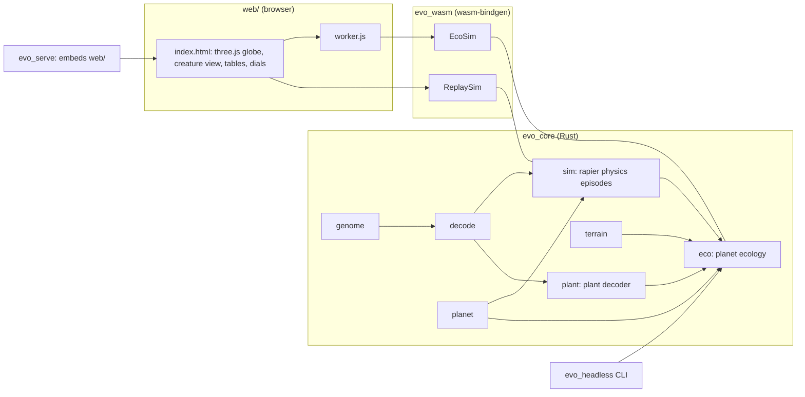
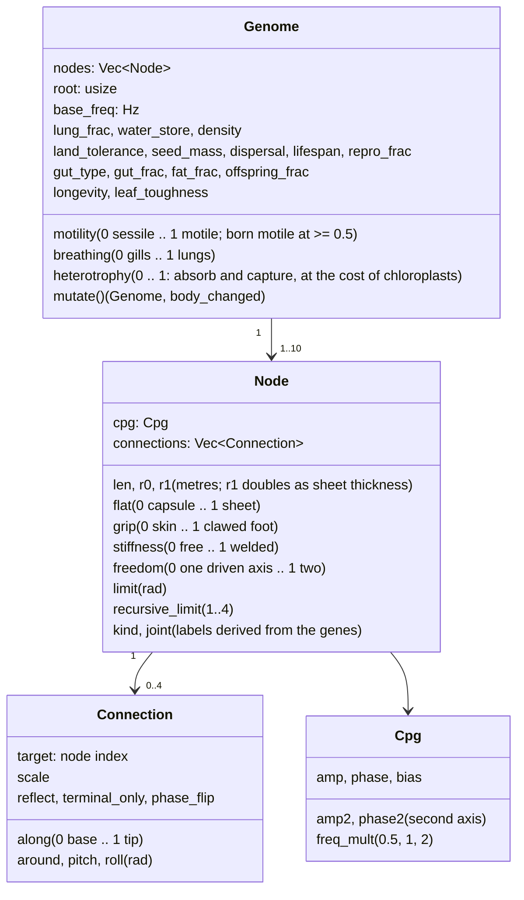
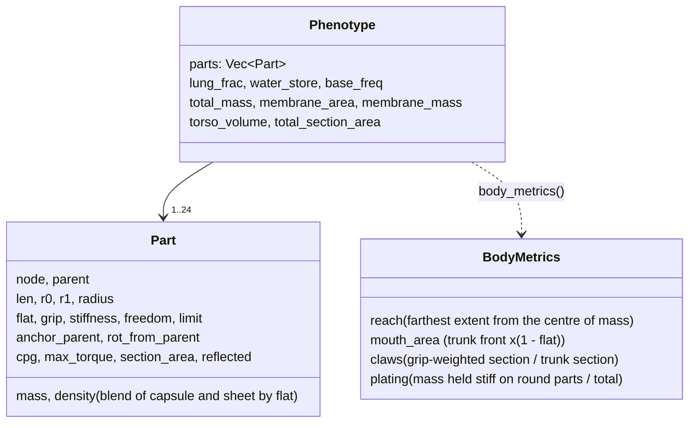
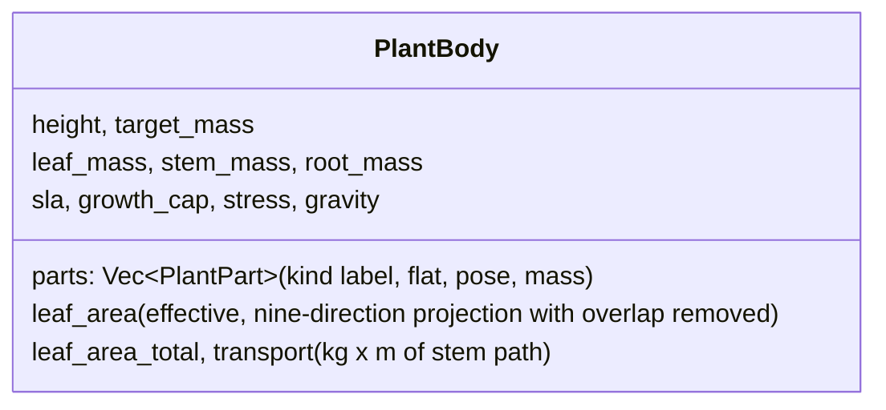
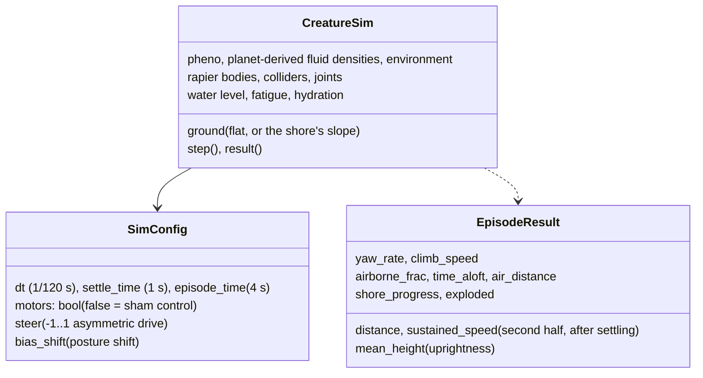
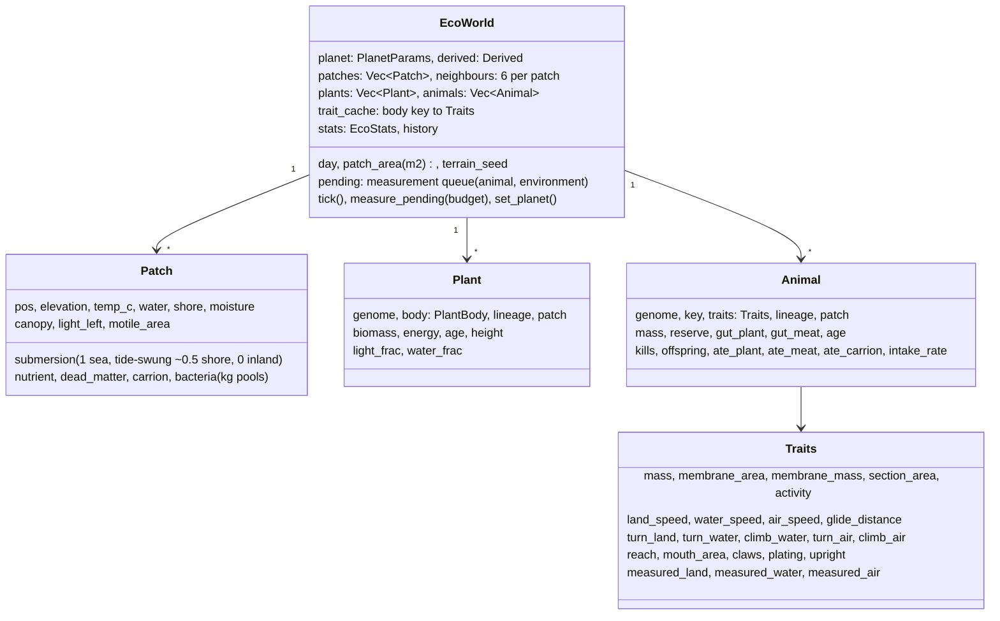
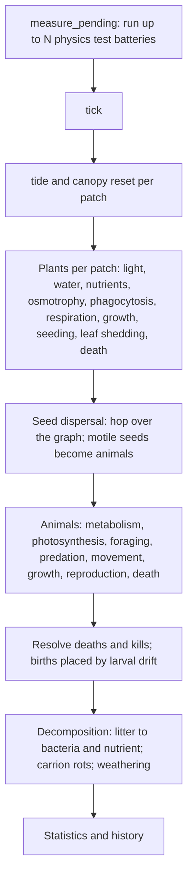
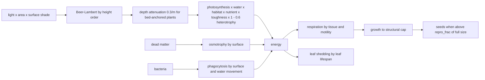
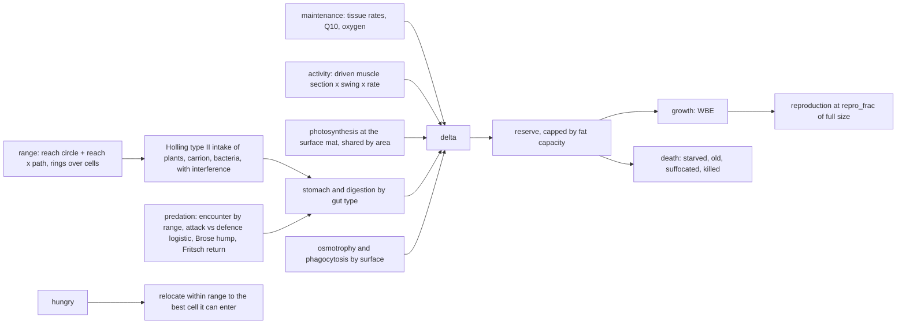
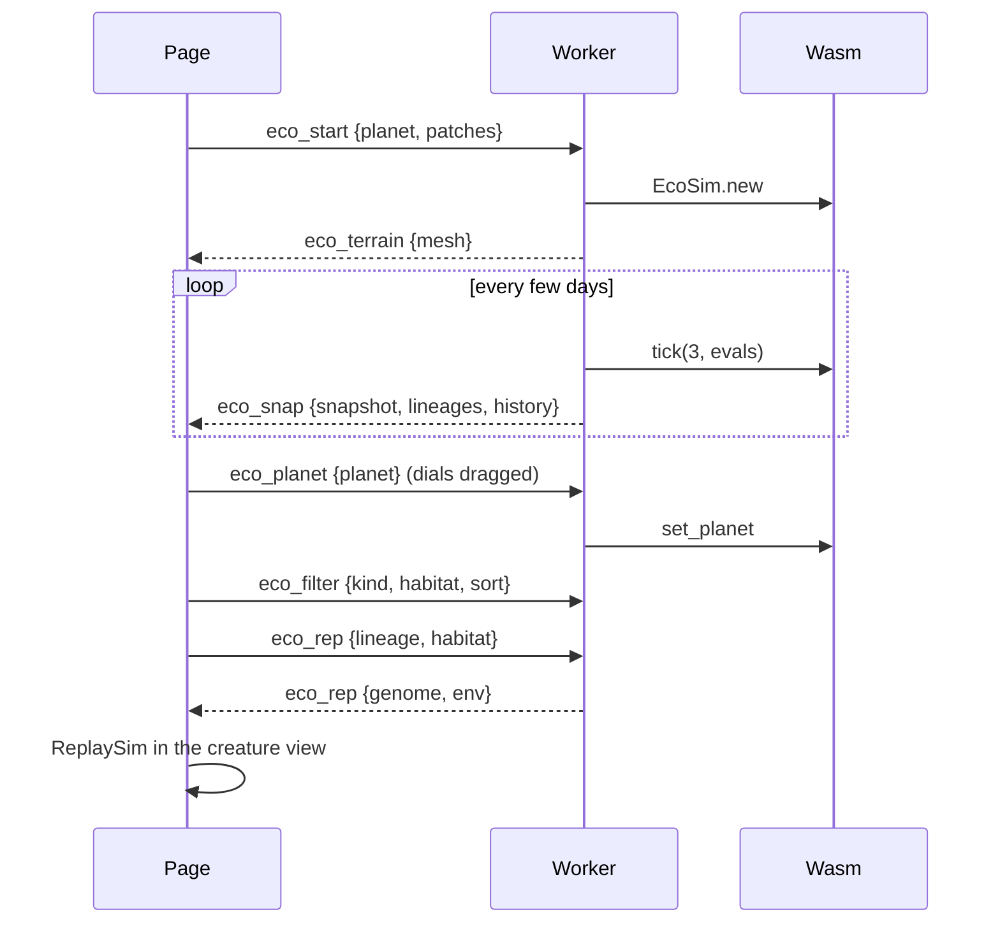

# Evo Planet: system specification

A reading guide to how the simulation is built: the data it holds, the
systems that act on it, the order they run in, and how the pieces talk to
each other. For *why* each rule exists and what it rests on, see
`MODEL.md` (design notes and audit log) and `RULES_AUDIT.md` (every number
and its backing). This document is the *what*.

Diagrams are Mermaid; GitHub renders them inline.

## 1. The two modes and the layers

There is one mode, the **planet ecology** (`eco.rs`): no score. Organisms
earn energy, pay for tissue and work, grow, breed and die on a sphere of
cells under a planet's gravity, atmosphere, light and water. The physics
(`sim.rs`) only measures what a body can do; nothing is ranked. An earlier
archive-evolution mode (a scored task with a MAP-Elites archive) was
removed on 2026-11-03.

## 2. Data structures

### 2.1 Genome (`genome.rs`)

A directed graph of nodes with recursion limits (Sims-style), plus global
genes. The same genome is read as an animal body (`decode.rs`) or as a
plant body (`plant.rs`); which reading the ecology uses follows from the
`motility` gene.

Mutation operators: nudge every scalar gene; nudge the four form genes
(±0.1, one in five ±0.4); add a random node; **duplicate a segment**
(copy a used node onto its host, serial or mirrored, keeping its
oscillator); add or remove a connection; mutate connection parameters and
pointers; change a recursion limit; motility drifts with an occasional
flagellum-sized jump. `garbage_collect` drops unreachable nodes. Old JSON
genomes without the form genes resolve them from the `kind`/`joint`
labels.

### 2.2 Phenotype (`decode.rs`)

`decode` expands the graph depth-first with per-path recursion counts,
clamps sizes (1 cm length, 4 mm radius floors), blends each part's mass,
tissue volume and muscle section by `flat`, applies lungs and stored
water to the trunk, clamps joined-part mass ratios to 12:1, and sums the
whole-body quantities. `placements` lays the parts out with the root at
the origin; `body_metrics` reads reach, mouth, claws and plating off that
geometry.

### 2.3 Plant body (`plant.rs`)

Each part is `flat` leaf (chord 2·r0, thickness from r1) and `1 − flat`
stem; whatever is below ground is root. Structure is checked two ways
under gravity: bending moment at every stem from the horizontal lever arm
of all it carries, and Euler buckling of columns; `growth_cap` is the
fraction of full size the stems can hold. `set_gravity` rescales stress
without re-decoding.

### 2.4 Physics episode (`sim.rs`)

Environments: Land (flat ground, bodies placed on it), Water (12 m deep;
a body starts where it would rest: floating, on the bed, or mid-water),
Air (launched at 3 m/s from 10 m; a stone's distance is subtracted),
Shore (a bed rising 12 cm/m through the waterline; probe only).

Forces per step: per-part fluid forces blended by `flat` (capsule drag
on three axial samples; panel lift and drag on four sub-panels), both
capped at the force that would stop the sample's share of the part in one
step; spin drag about the part's own axis; buoyancy from tissue volume;
rolling resistance on ground contact; joint motors driven by the CPG with
a Hill force-velocity limit, a passive spring per `stiffness`, and a
second axis per `freedom`.

### 2.5 Ecology (`eco.rs`)

`Traits` are what the physics and geometry say a body can do. They are
cached by body key, measured lazily (at birth, and again at half adult
mass), and a changed body inherits its parent's measured speeds as a
neutral prior until its own episodes run.

### 2.6 Planet and terrain (`planet.rs`, `terrain.rs`)

`PlanetParams` (gravity, pressure, O2 and CO2 fractions, mean
temperature, water coverage, humidity, insolation) derives `Derived`
(air and water density, O2 availability, NPP factor, aridity, flight
index, and so on). Terrain is ridged noise on a Fibonacci sphere; sea
level is the elevation quantile that matches water coverage; local
temperature falls with latitude and 6.5 °C per km. All of it can change
under a running world (`set_planet`).

## 3. Systems and the daily tick

### 3.1 The test battery (`measure_pending`)

For a body not yet measured in an environment, run:

| Episode | What it yields |
|---|---|
| Land, motors on | sustained speed, uprightness |
| Land, motors off | passive drift to subtract (sham control) |
| Land, asymmetric drive | turn rate |
| Water, motors on/off | sustained speed net of drift |
| Water, steer and posture shift | turn rate, climb speed |
| Air (if wing loading < 50 kg/m²) | glide beyond a stone, sustained flight, turn, climb |

The queue holds one request per (body, environment) and alternates
between the most-copied unmeasured body and the newest, so a spreading
body is checked soon and a new plan is not measured last.

### 3.2 Plants per patch

### 3.3 Animals per individual

### 3.4 Energy accounting

Every quantity is in kilograms of dry biomass equivalent per day; the
statistics report the flows (NPP, grazing, predation, scavenging, cost)
and death causes so the ledger can be audited. The `seed_ledger`,
`gait_audit`, `flier_audit` and `origin_probe` examples print the
per-individual ledgers behind the aggregate numbers.

## 4. Interfaces

### 4.1 wasm (`evo_wasm/src/lib.rs`)

| Object | Purpose |
|---|---|
| `EcoSim` | ecology: `tick(days, evals)`, `set_planet`, `snapshot_json`, `lineages_json(kind, habitat, sort, max)`, `representative_json`, `plant_representative_json`, `terrain_json`, `immigrate` |
| `ReplaySim` | one physics episode stepped in the browser: `parts_json` (with flat and grip), `transforms`, `com`, `distance`, `slope` |

### 4.2 Worker protocol (`web/worker.js`)

### 4.3 Page (`web/index.html`)

Globe (three.js, vertex colours from the snapshot), creature view (replay
with camera follow, continuous form rendering), ecology panel (stats,
energy flows, deaths, lineage table with filters), planet dials (live in
ecology mode), gamepad and TV layout. `window.evoDebug` exposes
`replayGenome`, `setZoom`, `replayTime`, `replayDistance` for scripted
screenshot audits.

### 4.4 Command line and tools

`evo_headless --eco --planet earth --days N --grid cells --seed S
[--patch-area m2] [--evals-per-day k]` prints the daily ledger and
lineage tables. Examples under `evo_core/examples/` are the audit probes
(see `MODEL.md`, "Audit tooling").

## 5. Invariants the model is held to

1. **Every rule is per area or per metre.** The cell size is a run
   parameter and must change nothing but resolution (tested at 25, 100
   and 400 m²; the coarse cut still disagrees, see `MODEL.md`).
2. **No binary switches in biology.** Form, joints, breathing, diet,
   maintenance, lifespan and reproduction are continua on genes. The one
   remaining split is in code: an organism is ticked as a plant below
   motility 0.5 and as a mover above it; nothing it pays or earns jumps
   there.
3. **Every measured ability has a control.** Speeds net of the
   motors-off twin; glide beyond a thrown stone.
4. **No founders, no rescues, no population guard.** Life starts as
   algae; extinction is a result.
5. **No claim without a replay looked at.** The audit examples and the
   page hook exist so that any number can be turned into a picture.

## 6. Known performance guards (not biology)

| Guard | Where | Binds when |
|---|---|---|
| Plant density caps | 0.48/m² sea, 0.08/m² land | always, in a full sea |
| Measurement budget | 8 bodies/day (headless), a few per slice (browser) | whenever births outrun it |
| Max nodes/parts | 10 nodes, 24 parts | rarely |
| Prey candidates per day | 3 | at high prey density |

The population guard was removed on 2026-11-03; cohorts (one object for
many identical small organisms) are the planned replacement for its
performance role and are not built yet.
